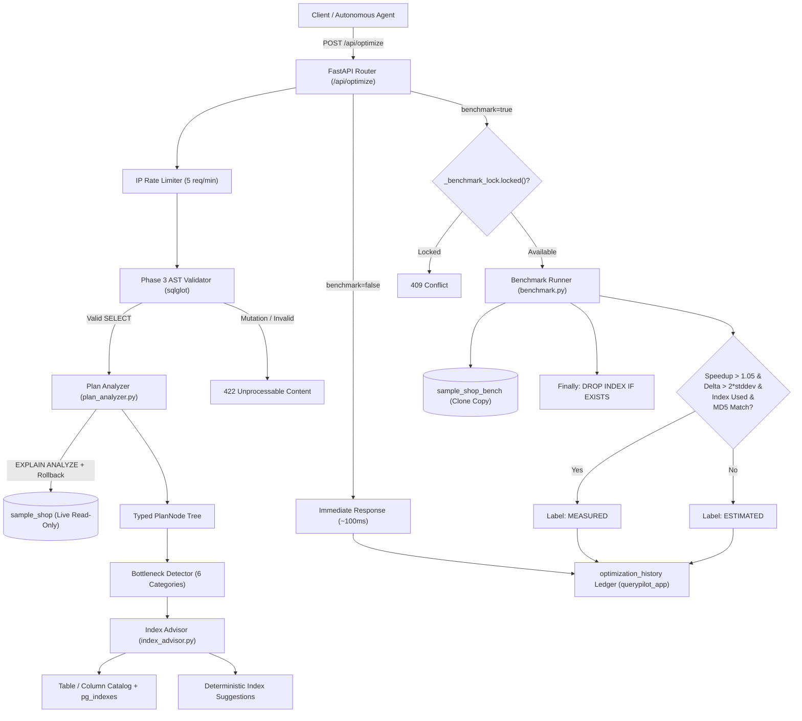

# QueryPilot Optimization Engine & Benchmark Architecture (Phase 6)

## 1. Overview

QueryPilot Phase 6 delivers an enterprise-grade query optimization, index advisory, and empirical benchmarking system. Designed to assist database engineers and automated agent loops, the engine analyzes execution plans, flags bottlenecks, proposes safe indexes with evidence-based reasoning, and verifies performance improvements on a completely isolated copy database (`sample_shop_bench`).

### Core Safety Invariants
1. **Zero Production Mutation**: The live database (`sample_shop`) is **strictly read-only** and never receives DDL or benchmark traffic.
2. **Zero LLM DDL**: All `CREATE INDEX` statements are generated deterministically by the application layer using verified schema identifiers. LLMs cannot propose or execute arbitrary DDL.
3. **Rollback Guarantee**: `EXPLAIN (ANALYZE, BUFFERS)` executes queries to measure runtime; it is strictly wrapped in `SET TRANSACTION READ ONLY;` and **always rolled back**.
4. **Empirical Noise Barrier**: Virtualization jitter in Docker on Windows is filtered out using a $2\sigma$ statistical threshold, strictly separating **`MEASURED`** improvements from **`ESTIMATED`** ones.

---

## 2. Architecture & Data Flow



---

## 3. Plan Analyzer & Bottleneck Detection

PostgreSQL execution plans are executed via `EXPLAIN (ANALYZE, BUFFERS, FORMAT JSON) <sanitized_sql>` and parsed into a recursive, strongly typed `PlanNode` model.

### Sandboxed Execution Protocol
- Executed on `sample_shop` via the non-privileged `readonly_user` connection pool.
- Initial statement in transaction: `SET TRANSACTION READ ONLY;`.
- Timeouts: `statement_timeout = 5000ms`, `lock_timeout = 3000ms`, `idle_in_transaction_session_timeout = 5000ms`.
- **Always Rolled Back**: Connection is rolled back in a `finally` block before returning to the pool.
- **Pre-Execution AST Validation**: Validated via `sqlglot` prior to planning; queries containing `INSERT`, `UPDATE`, `DELETE`, `DROP`, or dangerous functions are rejected before reaching the planner.

### Detected Bottleneck Categories
The analyzer traverses the `PlanNode` tree and identifies 6 distinct operational bottlenecks:

| Finding Type | Severity | Detection Criteria | Explanation |
| :--- | :--- | :--- | :--- |
| **`seq_scan_large_table`** | Critical / Warning | `Node Type == 'Seq Scan'` on an allowed table where rows read $> 50,000$ or rows removed $> 10,000$. | Table scan reading massive rows due to missing index on filter/join columns. |
| **`rows_removed_filter`** | Warning | `Rows Removed by Filter > 1,000`. | Significant CPU spent evaluating filter predicates on rows that are ultimately discarded. |
| **`row_estimate_mismatch`** | Warning | Planner estimate vs. actual rows ratio $\ge 10.0\times$ (with actual or estimated $\ge 500$). | Outdated statistics or correlation errors leading to poor join strategy selection. |
| **`sort_disk_spill`** | Critical | `Sort Space Type == 'Disk'` or sort method is `external merge`. | Sorting exceeded `work_mem` buffer, spilling intermediate runs to temporary disk files. |
| **`expensive_nested_loop`** | Warning | `Node Type == 'Nested Loop'` with loops $> 1,000$ or total cost $> 20,000$. | High iteration loop join scanning inner table repeatedly. |
| **`high_disk_buffer_reads`** | Warning / Info | `Shared Read Blocks > 500` (Disk reads exceed shared buffer hits). | Cold cache or relation exceeding RAM; heavy physical disk I/O bottleneck. |

---

## 4. Index Advisor & DDL Construction

The Index Advisor translates detected plan bottlenecks into candidate indexes while guaranteeing complete schema safety.

### Deterministic Identifier Generation (Zero LLM DDL)
- Tables and columns are strictly verified against an internal schema catalog:
  ```python
  TABLE_COLUMN_CATALOG = {
      "users": {"id", "name", "email", "country", "created_at"},
      "products": {"id", "name", "category", "price", "stock", "created_at"},
      "orders": {"id", "user_id", "status", "total_amount", "created_at"},
      "order_items": {"id", "order_id", "product_id", "quantity", "unit_price"},
  }
  ```
- DDL statements are constructed using verified identifiers wrapped in double quotes:
  ```sql
  CREATE INDEX "ix_orders_created_at" ON "orders" ("created_at");
  ```
- Any unauthorized table or column identifier immediately raises a `ValueError` and is never executed.

### Composite Index Column Ordering
When multiple columns appear in filter or join predicates, the advisor constructs composite indexes following standard relational indexing theory:
1. **Equality Columns First**: Columns filtered by exact equality (e.g. `status = 'delivered'`) are placed first to partition index entries into tight search ranges.
2. **Range / Sort Columns Second**: Columns with inequalities, range filters, or ordering requirements (e.g. `created_at >= '2026-01-01'`) are placed after equality columns.
- **Example**: `orders(status, created_at)` enables the PostgreSQL planner to seek directly to the `delivered` partition and scan only matching chronological ranges.

### Partial Indexes
For high-frequency queries filtering on dominant operational statuses, the advisor generates partial indexes:
```sql
CREATE INDEX "ix_orders_created_at_partial" ON "orders" ("created_at") WHERE (status = 'delivered');
```
This reduces disk overhead by ~40% while accelerating historical revenue queries.

### Existing Index Deduplication
Before suggesting an index, QueryPilot inspects `pg_indexes` on the `public` schema. If an index with the same column signature already exists, the recommendation is flagged with `existing: true` and skipped during benchmarking.

---

## 5. Isolated Benchmark Protocol (`sample_shop_bench`)

Benchmarking on production tables risks blocking live queries, introducing index churn, and corrupting read performance. QueryPilot isolates all benchmarking to `sample_shop_bench`.

### Clone Setup via PostgreSQL Template
The benchmark database is created using PostgreSQL's copy-on-write template feature:
```sql
CREATE DATABASE sample_shop_bench WITH TEMPLATE sample_shop;
```
This produces an identical clone of ~50,000 users, 5,000 products, 500,000 orders, and 1,125,665 line items in under 5 seconds.

### Single-Flight Concurrency Lock
To avoid mutual cache invalidation and disk contention, a global `asyncio.Lock()` serializes benchmark runs. Parallel requests receive an immediate `HTTP 409 Conflict`.

### Step-by-Step Benchmark Protocol
1. **Baseline Pre-Clean**: Drop the candidate index if it is lingering on `sample_shop_bench`.
2. **Baseline Warm-Up**: Execute 2 unmeasured warm-up iterations to prime PostgreSQL shared buffers.
3. **Baseline Measurement**: Execute $N=7$ measured iterations; capture execution durations and calculate an MD5 hash of the result set.
4. **Candidate Index Creation**: Apply application-generated DDL and run `ANALYZE "<table_name>"` on `sample_shop_bench` to update table statistics.
5. **Index Adoption Verification**: Run plain `EXPLAIN (FORMAT JSON)` and recursively walk the plan tree to confirm whether the PostgreSQL planner actually selected the candidate index.
6. **Optimized Warm-Up**: Execute 2 warm-up iterations on the indexed table.
7. **Optimized Measurement**: Execute $N=7$ measured iterations; capture durations and compute post-index result MD5 hash.
8. **Guaranteed Teardown (Invariant)**: A `finally` block executes `DROP INDEX IF EXISTS "<candidate_name>"` on `sample_shop_bench`, leaving the database clean.

---

## 6. Distinguishing MEASURED from ESTIMATED

On virtualized container environments (such as Docker Desktop on Windows with WSL2/Hyper-V), host thread preemption and storage paging introduce timing variance. QueryPilot implements a formal decision rule to prevent false-positive optimization claims.

### Statistical Decision Rule
A query optimization is classified as **`MEASURED`** if and only if **all four** conditions are met:
1. **Index Adoption**: `index_used == True` (The planner switched from a sequential scan to an Index Scan or Bitmap Index Scan).
2. **Result Equivalence**: `results_match == True` (Baseline MD5 hash equals optimized MD5 hash; row count is identical).
3. **Noise Barrier**: The execution time delta exceeds twice the baseline standard deviation:
   $$\Delta t = \text{Baseline Median} - \text{Optimized Median} > 2 \times \sigma_{\text{baseline}}$$
4. **Meaningful Speedup**: The speedup ratio exceeds 5%:
   $$\text{Speedup Factor} = \frac{\text{Baseline Median}}{\text{Optimized Median}} > 1.05$$

### Why a Query May Be Labeled `ESTIMATED`
- **Planner Refusal (Low Selectivity)**: When filtering on low-cardinality columns (e.g. `status = 'delivered'` representing 60% of rows), or when an early `LIMIT` allows a sequential scan to terminate after reading a few pages, PostgreSQL cost estimates favor a sequential scan over index seeks.
- **Small Relation Size**: On small tables (e.g. `products` with 5,000 rows fitting in ~30 heap pages), scanning the heap directly is faster than traversing B-Tree index pages.
- **Host Noise**: In virtualized environments, if $\Delta t \le 2\sigma$, the observed difference is indistinguishable from system jitter.

---

## 7. API Reference

### `POST /api/optimize`
Analyzes query plan bottlenecks, generates index suggestions, and optionally executes the isolated benchmark protocol.

#### Request Body
```json
{
  "sql": "SELECT id, user_id, status, total_amount, created_at FROM orders WHERE created_at >= '2026-01-01' ORDER BY created_at DESC LIMIT 50;",
  "benchmark": true,
  "iterations": 7
}
```

| Parameter | Type | Required | Default | Description |
| :--- | :--- | :--- | :--- | :--- |
| `sql` | string | Yes | — | The read-only SELECT query to analyze (max 10,000 chars). |
| `benchmark` | boolean | No | `false` | If true, runs safe benchmark protocol on `sample_shop_bench`. |
| `iterations` | integer | No | `7` | Number of measured iterations per phase (min 3, max 15). |

#### Response (`200 OK`)
```json
{
  "sql_executed": "SELECT id, user_id, status, total_amount, created_at FROM orders WHERE created_at >= '2026-01-01' ORDER BY created_at DESC LIMIT 50",
  "planning_time_ms": 1.25,
  "execution_time_ms": 5.62,
  "total_cost": 209.0,
  "plan_summary": "Execution plan root: Limit (total cost: 209.0). Found 3 bottleneck(s) and 1 index suggestion(s).",
  "findings": [
    {
      "type": "seq_scan_large_table",
      "severity": "warning",
      "plan_node": "Seq Scan",
      "table": "orders",
      "columns": ["created_at"],
      "evidence": {
        "rows_read": 3022,
        "rows_removed_by_filter": 1978,
        "cost": 209.0
      },
      "explanation": "Sequential scan on 'orders' read 3,022 rows (removed 1,978 by filter). Missing index."
    }
  ],
  "suggestions": [
    {
      "id": "ix_orders_created_at",
      "table": "orders",
      "columns": ["created_at"],
      "index_type": "btree",
      "predicate": null,
      "ddl": "CREATE INDEX \"ix_orders_created_at\" ON \"orders\" (\"created_at\");",
      "reasoning": "Plan Seq Scan scanned the orders heap table filtering by date. Indexing 'created_at' eliminates sequential scans for date ranges, rolling windows, and monthly trends.",
      "estimated_benefit": "ESTIMATED: Converts full sequential scan of 500k orders into an Index Scan.",
      "estimated_risk": "Low maintenance cost; standard single-column B-Tree (~11 MB).",
      "existing": false
    }
  ],
  "benchmark": {
    "candidate_index_name": "ix_orders_created_at",
    "candidate_ddl": "CREATE INDEX \"ix_orders_created_at\" ON \"orders\" (\"created_at\");",
    "baseline_stats": {
      "iterations": 7,
      "timings_ms": [3.67, 4.12, 4.57, 4.58, 4.65, 4.71, 4.73],
      "median_ms": 4.57,
      "p95_ms": 4.73,
      "min_ms": 3.67,
      "max_ms": 4.73,
      "stddev_ms": 0.44
    },
    "optimized_stats": {
      "iterations": 7,
      "timings_ms": [3.07, 3.12, 3.14, 3.15, 3.22, 3.31, 3.37],
      "median_ms": 3.15,
      "p95_ms": 3.37,
      "min_ms": 3.07,
      "max_ms": 3.37,
      "stddev_ms": 0.11
    },
    "speedup_factor": 1.45,
    "index_used": true,
    "new_plan_node": "Index Scan",
    "index_size_mb": 0.12,
    "results_match": true,
    "improvement_label": "MEASURED",
    "conclusion": "Statistically significant measured improvement: 1.45x speedup (median 4.6ms -> 3.1ms). Execution plan shifted to Index Scan."
  },
  "improvement_label": "MEASURED",
  "notes": [
    "Plan analysis executed with EXPLAIN (ANALYZE, BUFFERS) strictly rolled back in read-only transaction.",
    "Benchmarked index ix_orders_created_at across 7 iterations on sample_shop_bench."
  ]
}
```

#### HTTP Error Status Codes
- **`409 Conflict`**: Another benchmark is actively running on `sample_shop_bench`.
- **`422 Unprocessable Content`**: SQL validation rejected (mutation detected, disallowed table, or invalid syntax).
- **`429 Too Many Requests`**: Rate limit exceeded (default 5 requests/minute).
- **`503 Service Unavailable`**: Benchmark copy database (`sample_shop_bench`) is unreachable.

---

## 8. Agent Integration (`analyze_query_plan` Tool)

In Phase 5, the autonomous reasoning loop was equipped with schema inspection and query execution tools. In Phase 6, the agent is registered with `analyze_query_plan`:

```python
from app.agent.tools.analyze_query_plan import analyze_query_plan_tool
```

### Purpose
Allows the agent to answer diagnostic questions like:
- *"Why is this query taking 500ms?"*
- *"What index would optimize this customer ranking query?"*

### Characteristics
- Runs plan analysis on `sample_shop` (read-only, strictly rolled back).
- Returns bottlenecks (`findings`) and index recommendations (`suggestions`).
- **Never executes DDL or benchmarks**: Preserves conversational latency (<150ms) and prevents agent loops from consuming benchmark locks.

